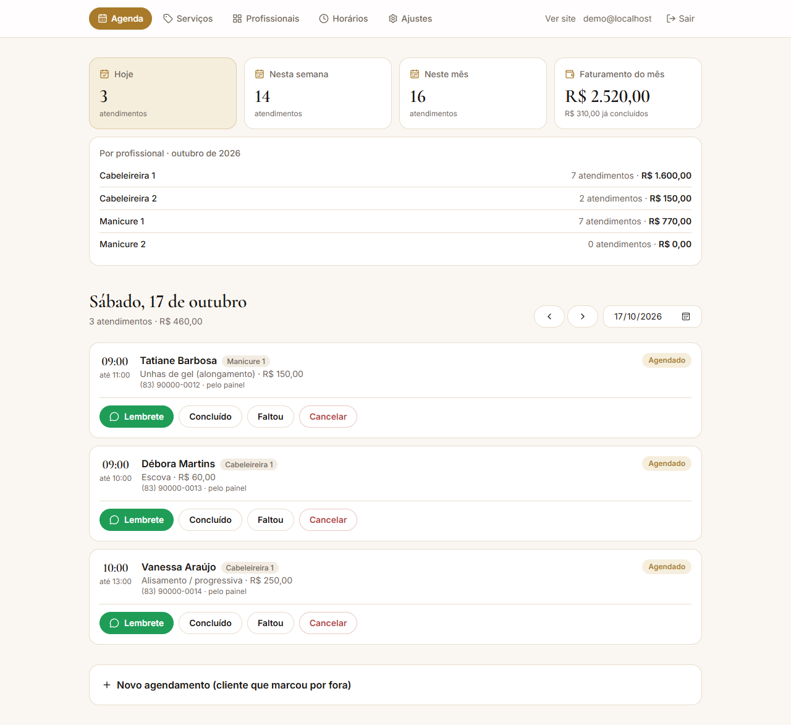

# Studio Hair Premium · Agendamento online

Site de agendamento para um salão de beleza em Manaíra, João Pessoa (PB): unhas de gel, megahair, loiros e alisamentos, com uma equipe de cabeleireiras e manicures.
Hoje o agendamento desses negócios é todo pelo WhatsApp; este site deixa a cliente marcar sozinha, a qualquer hora,
vendo só os horários realmente livres.

**🔗 Ver no ar:** https://site-studio-hair.vercel.app · **Painel:** https://site-studio-hair.vercel.app/admin (clique em "Entrar (demonstração)")

> Projeto de demonstração: serviços, preços e agendamentos do painel são exemplos.
> Feito a partir de um template de agendamento meu, reaproveitado para vários negócios.

| Site | Agendamento | Celular |
|---|---|---|
|  |  |  |



## O que faz

**Para a cliente**
- Escolhe o serviço (com preço e duração), o dia e um horário livre, e informa nome e WhatsApp. Leva menos de um minuto.
- Ao terminar, pode avisar o negócio pelo WhatsApp com a mensagem já escrita.

**Painel do negócio**
- Resumo do dia, da semana e do mês, com **faturamento** e total por profissional.
- Agenda do dia com lembrete por WhatsApp e status (concluído, faltou, cancelado).
- Agendamento manual para quem marcou por fora.
- Serviços, profissionais, horário de funcionamento, bloqueios (folga, feriado) e textos do site, tudo editável.


## Destaques técnicos

- **Sem conflito de horário, garantido pelo banco:** uma *exclusion constraint* do PostgreSQL (`btree_gist`) impede
  dois agendamentos sobrepostos na mesma agenda, mesmo com duas pessoas clicando ao mesmo tempo.
- **Várias agendas independentes:** cada profissional tem a própria agenda; o site oferece um horário se
  pelo menos uma profissional que faz aquele serviço estiver livre e já reserva com ela.
- **Disponibilidade calculada no servidor:** expediente, pausas, bloqueios, antecedência mínima e janela de dias,
  no fuso `America/Fortaleza`. Valores sempre em centavos.
- **Banco que se monta sozinho:** num banco Neon vazio, o schema e os dados iniciais são aplicados no primeiro acesso.
- **Roda sem configurar nada:** em desenvolvimento usa PGlite (Postgres dentro do Node), já com dados de exemplo.
- **Painel protegido:** login com Google (Auth.js) liberado só para e-mails autorizados; modo demonstração
  separado para apresentar o painel a clientes.
- **Pensado para WhatsApp:** depois de agendar, a cliente confirma por mensagem pronta; o painel gera lembretes
  com um clique.
- **Imagem de compartilhamento gerada por código** (`next/og`), para o link ficar bonito no WhatsApp e no Instagram.

## Tecnologias

Next.js 16 (App Router, Server Actions) · React 19 · TypeScript · Tailwind CSS 4 · PostgreSQL no **Neon** ·
Auth.js (Google) · Zod · Vitest · deploy na **Vercel**.

## Rodar localmente

```bash
npm install
npm run dev
```

Site em http://localhost:3000 e painel em http://localhost:3000/admin (botão "Entrar (demonstração)").
Sem `DATABASE_URL`, os dados ficam num Postgres local em `.data/` (`npm run demo:reset` zera).

Testes: `npm test` (regras de disponibilidade, formatação e a constraint anti-conflito no banco).
